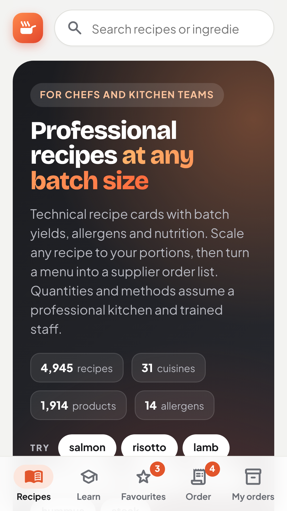
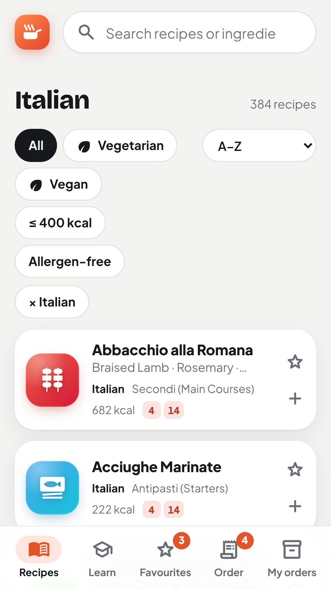
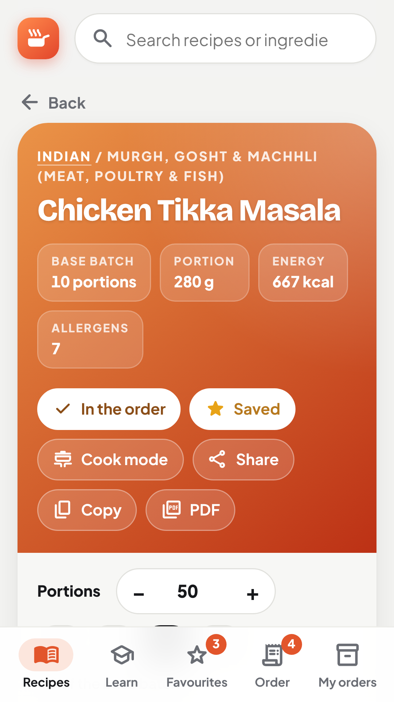
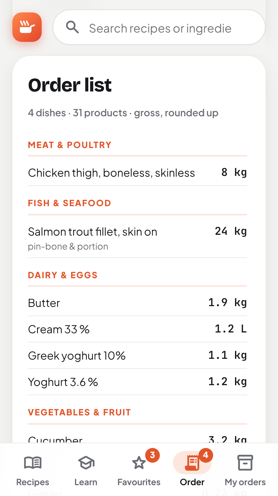
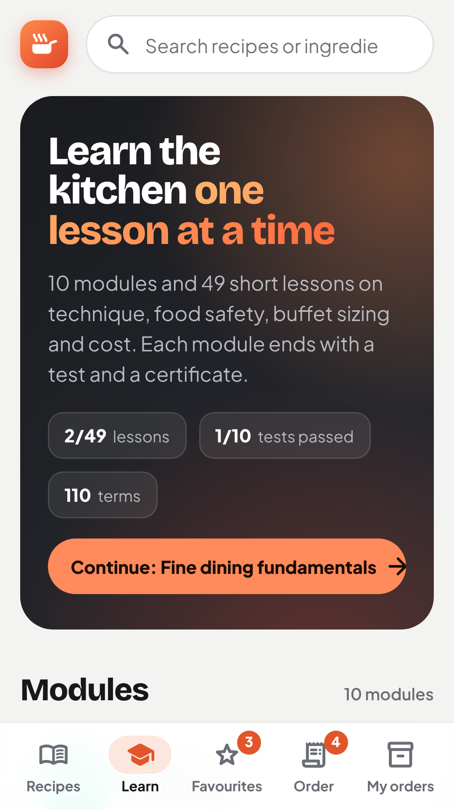
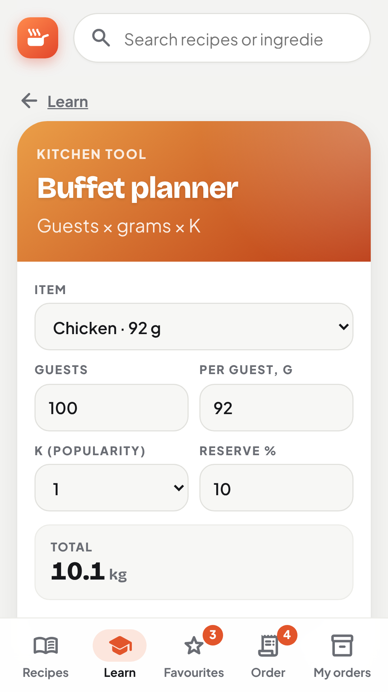
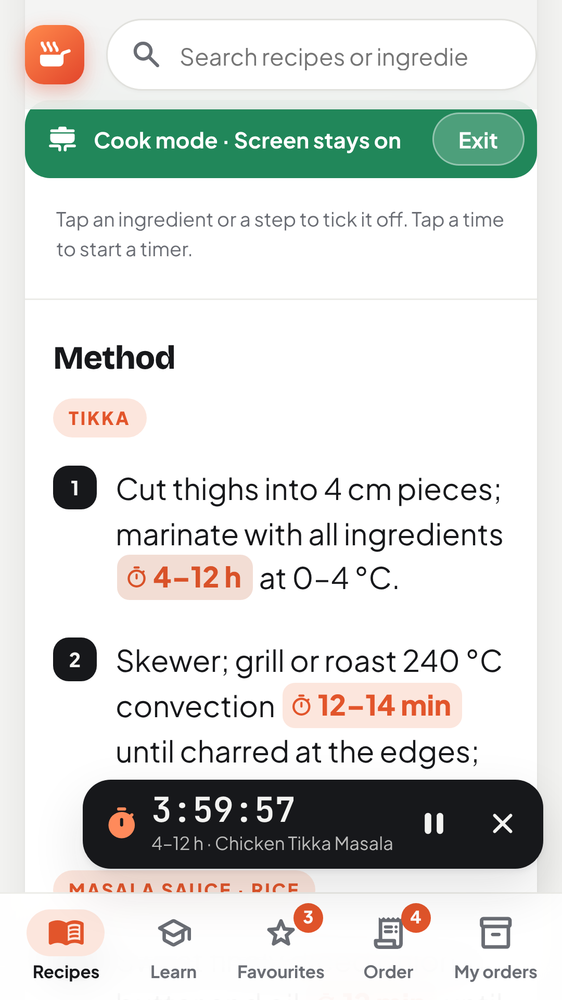

# Chefsheet

**Professional recipes at any batch size.** 4,900+ technical recipe cards, supplier order lists and kitchen training in one app.

**Open the app:** https://plamenn000234.github.io

## Who it is for

Chefsheet is made for **kitchen professionals**: chefs, sous chefs, chefs de partie, pastry chefs, banquet and buffet teams, catering and hotel kitchens, and culinary students.

Recipes are written as professional technical cards: net weights in grams, batch yields, portion sizes, allergens and storage. Quantities and methods assume a professional kitchen and trained staff.

## What it does

- **Scale any recipe.** 4,945 recipes in 103 collections: cuisines, courses, buffet, banquet, pastry, bakery, fine dining and more. Set your portions and every component follows.
- **Cook mode.** Larger text, the screen stays on, and every time in a method step starts a timer with one tap.
- **Order lists.** Add dishes, set guests, grams per guest and a popularity factor. Get a gross (as-bought) order list by section with trim losses included, as PDF or CSV.
- **Allergens and nutrition.** The 14 allergens on every recipe, allergen-free, vegetarian and vegan filters, calories per portion.
- **Learn.** 10 modules and 49 short lessons, tests with PDF certificates, and kitchen tools: doneness, sous-vide, salt and brines, yield, baker's percentage, buffet planner, food cost, glossary EN · BG · RU.
- **Works offline** once installed. No account, no ads, no tracking.

## Screenshots

| Recipe library | Collections | Recipe card |
|---|---|---|
|  |  |  |

| Order list | Learn | Buffet planner | Cook mode |
|---|---|---|---|
|  |  |  |  |

## Install on your phone

Open https://plamenn000234.github.io in Chrome (Android) or Safari (iPhone) and choose **Add to Home screen**.

## Good to know

Allergen, diet and nutrition data are derived from the listed ingredients and are estimates. Always check the labels of the products you buy. Some recipes contain alcohol.

[Privacy policy](https://plamenn000234.github.io/privacy.html) · Contact: plamenn000234@gmail.com

© 2026 Chefsheet. All rights reserved. Recipes, texts and code may not be copied or redistributed without permission.
